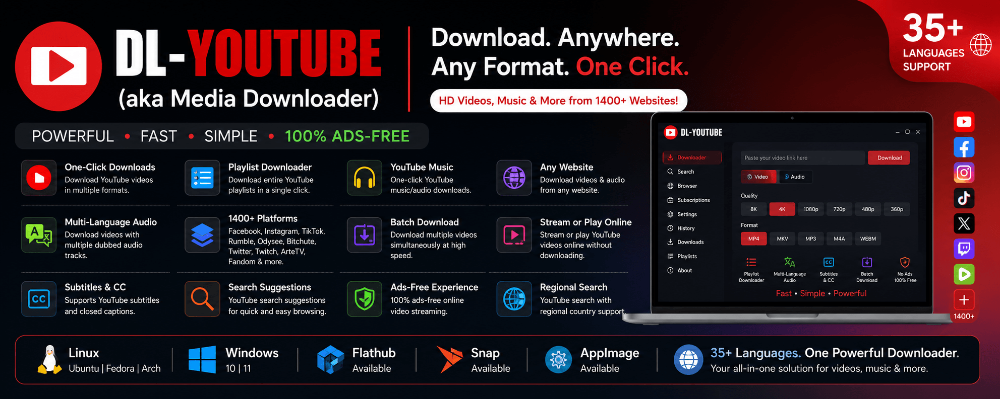
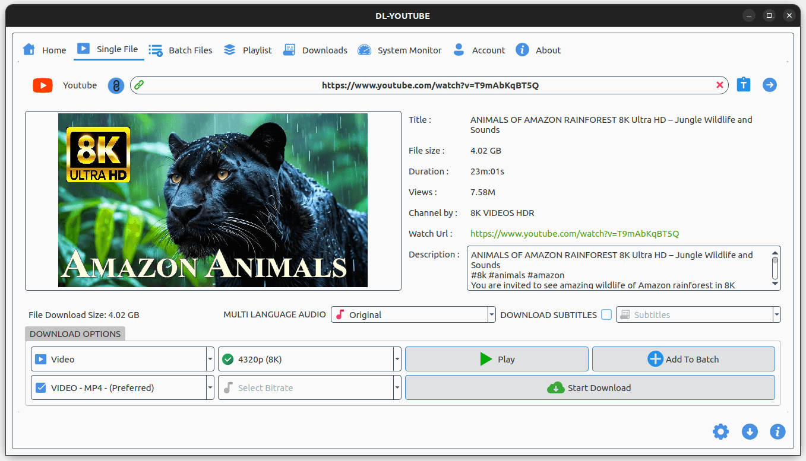
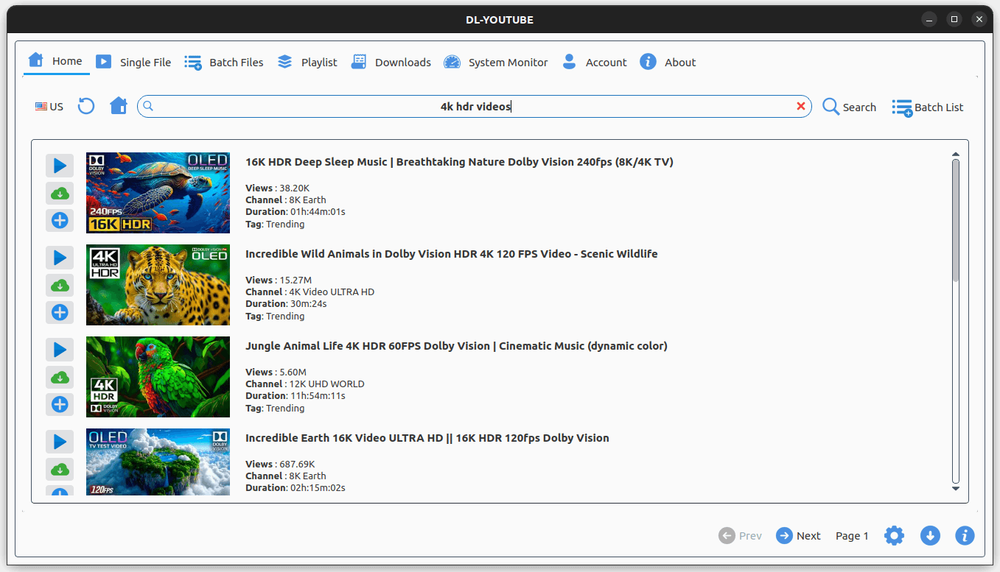
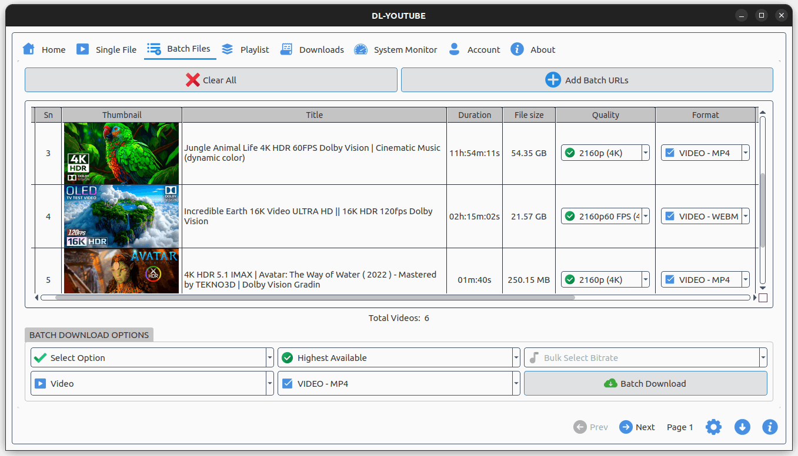
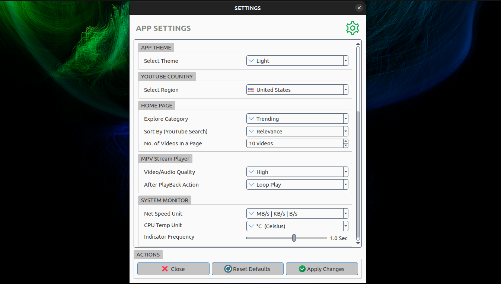

# DL-YouTube (Media Downloader): download video and audio from 1400+ sites on Linux and Windows

DL-YouTube, also called Media Downloader, is a desktop video downloader for Linux and Windows. It saves video and audio from YouTube, Instagram, TikTok, Facebook, X (Twitter), Twitch, Reddit, SoundCloud and 1400+ other websites, in HD or as MP3, one at a time or in batches, with subtitles. The interface comes in 35+ languages. It has no ads and no trackers, and you don't need a browser extension.

<p align="center">
  
</p>

<p align="center">
  <a href="https://flathub.org/apps/details/com.warlordsoftwares.media-downloader"></a>
  <a href="https://snapcraft.io/youtube-dl-pro"></a>
  <a href="https://github.com/rishabh3354/YOUTUBE-DL-PRO/releases/latest"></a>
</p>

<p align="center">
  
  
  
  
  
</p>

> Installed 220,000+ times on Flathub.

## Contents

- [Download and install](#download-and-install)
- [Features](#features)
- [What you can download](#what-you-can-download)
- [Supported sites](#supported-sites)
- [Screenshots](#screenshots)
- [System requirements](#system-requirements)
- [FAQ](#faq)
- [How it compares](#how-dl-youtube-compares)
- [Responsible use](#responsible-use)
- [More apps](#more-apps-by-warlord-softwares)

## Download and install

<p align="center">
  <a href="https://snapcraft.io/youtube-dl-pro"></a>&nbsp;
  <a href="https://flathub.org/apps/details/com.warlordsoftwares.media-downloader"></a>&nbsp;
  <a href="https://github.com/rishabh3354/YOUTUBE-DL-PRO/releases/latest"></a>&nbsp;
  <a href="https://github.com/rishabh3354/YOUTUBE-DL-PRO/releases/latest"></a>
</p>

### Install on Linux (terminal)

```bash
sudo snap install youtube-dl-pro
```

```bash
flatpak install flathub com.warlordsoftwares.media-downloader
```

### Install on Linux (AppImage, any distro)

Download the latest `.AppImage` from the [releases page](https://github.com/rishabh3354/YOUTUBE-DL-PRO/releases/latest), then:

```bash
chmod +x DL-YouTube-x86_64.AppImage
./DL-YouTube-x86_64.AppImage
```

### Install on Windows

Download the Windows installer from the [releases page](https://github.com/rishabh3354/YOUTUBE-DL-PRO/releases/latest) and run it. It supports 64-bit Windows 10 and Windows 11.

## Features

- Download from 1400+ websites with one app, instead of a different sketchy site for every platform.
- Paste a link and save the video as MP4, WEBM or MKV in one click.
- Save just the audio of any supported video as MP3, M4A, WAV, FLAC or Opus.
- Queue a whole YouTube playlist at once.
- Pick the dubbed audio track you want instead of the default one.
- Save subtitle and closed-caption tracks next to the video.
- Run many downloads at the same time.
- Search YouTube inside the app, with results for your region.
- Preview a video in the app, without ads, before you save it.
- The whole interface is translated into 35+ languages.
- No ads, no trackers, no bundled installers.

## What you can download

| Task | Result |
|---|---|
| Download a YouTube video | MP4 / WEBM at your chosen resolution |
| Download a YouTube playlist | Every video queued automatically |
| Convert YouTube to MP3 | Audio only, at high bitrate |
| Download an Instagram video or reel | Saved as MP4 |
| Download a TikTok video | Saved as MP4, without the watermark where possible |
| Download a Facebook video | Saved as MP4 |
| Download a video from X (Twitter) | Saved as MP4 |
| Download a Twitch VOD or clip | Saved locally for offline viewing |
| Download a Reddit video | Video and audio merged into one file |
| Download SoundCloud audio | Saved as MP3 / M4A |
| Download with subtitles | Subtitle tracks saved with the video |
| Batch download a list of links | Paste many URLs and let the queue run |

## Supported sites

More than 1400 sites, including:

`YouTube` · `YouTube Music` · `Instagram` · `TikTok` · `Facebook` · `X (Twitter)` · `Twitch` · `Vimeo` · `Dailymotion` · `Reddit` · `SoundCloud` · `Rumble` · `Odysee` · `BitChute` · `Brighteon` · `Pinterest` · `LinkedIn` · `Snapchat` · `ESPN` · `Yahoo` · `Arte` · `Fandom` · `Bilibili` · `Wikimedia`

## Screenshots

| Video download | In-app YouTube search |
|---|---|
|  |  |

| Batch downloading | Settings |
|---|---|
|  |  |

## System requirements

| | Minimum |
|---|---|
| Linux | Ubuntu 20.04+, Debian 11+, Fedora 36+, Arch, or any distro that runs Flatpak / Snap / AppImage |
| Windows | Windows 10 or Windows 11, 64-bit |
| Architecture | x86_64 |
| RAM | 4 GB |
| Network | Broadband recommended for HD downloads |

## FAQ

### Is DL-YouTube free?

It is free to download and use. A one-time Pro upgrade removes the limits and unlocks every feature. There is no subscription. See [plans and pricing](https://warlordsoftwares.com/apps/plans-and-pricing/).

### Does it work on Linux?

Yes, Linux is its main platform. Install it from Flathub, the Snap Store, or as a portable AppImage on Ubuntu, Debian, Fedora, Arch, Linux Mint, Pop!\_OS and others.

### Which sites does it support?

More than 1400, including YouTube, Instagram, TikTok, Facebook, X (Twitter), Twitch, Vimeo, Reddit, SoundCloud, Rumble and Odysee.

### How do I download a video as MP3?

Paste the link, switch the output to audio, pick MP3 (or FLAC / M4A / Opus) and download. Only the audio track is saved.

### Can it download a whole playlist?

Yes. Paste a playlist URL and every video in it is queued for download.

### Does it download subtitles?

Yes. It can save subtitle and closed-caption tracks next to the video.

### Does it contain ads, trackers or bundled software?

No. It ships from Flathub, the Snap Store and signed GitHub releases with no advertising, no analytics and no bundled installers.

### Is it open source?

No. DL-YouTube is a proprietary desktop application. This repository holds the releases, packaging metadata, issue tracker and documentation. The application source is not here.

### How is this different from 4KTUBE?

DL-YouTube is the general-purpose downloader, with the widest site coverage. [4KTUBE](https://github.com/rishabh3354/4KTUBE-MEDIA-DOWNLOADER) focuses on YouTube: the highest resolutions (4K / 8K), playlists and in-app search.

## How DL-YouTube compares

- Online downloader sites (y2mate, SaveFrom, ssyoutube and similar) show pop-ups and fake buttons, cap the quality, and send your links through their servers. DL-YouTube runs on your computer and has no quality cap.
- Browser extensions get pulled from extension stores often and break when a site changes.
- Command-line tools (yt-dlp, youtube-dl) are powerful and free, but you drive them with flags. DL-YouTube adds an interface, a download queue, search and previews.
- Paid Windows downloaders (SnapDownloader, iTubeGo, Allavsoft, VideoHunter) are built for Windows first and charge a subscription. DL-YouTube is a one-time purchase and supports Linux as fully as Windows.

## Responsible use

Use DL-YouTube to save content you have the right to save: your own uploads, Creative Commons material, public-domain video, and content you have permission to keep offline. Please respect copyright and the terms of service of the sites you download from.

## More apps by Warlord Softwares

Other apps by Warlord Softwares are listed on [warlordsoftwares.com](https://warlordsoftwares.com/).

## Links

- Website: [warlordsoftwares.com](https://warlordsoftwares.com/)
- Flathub: [com.warlordsoftwares.media-downloader](https://flathub.org/apps/details/com.warlordsoftwares.media-downloader)
- Snap Store: [snapcraft.io/youtube-dl-pro](https://snapcraft.io/youtube-dl-pro)
- Issues: [github.com/rishabh3354/YOUTUBE-DL-PRO/issues](https://github.com/rishabh3354/YOUTUBE-DL-PRO/issues)

## License

DL-YouTube is proprietary software. © 2024–2026 Rishabh Bhardwaj / Warlord Softwares. See [LICENSE](LICENSE).
